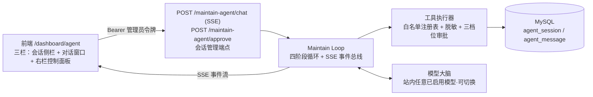

# AgenticAPI 站点维护 Agent · 设计文档

> 适用系统版本：**v0.11.0** ｜ 文档版本：v2.1 ｜ 日期：2026-11-07 ｜ 机制均已与代码核对
>
> 工具 / Skill 明细见**附录 A / B**；改代码先看第 7 章代码地图；历史演进见 [`changelog/维护Agent版本演进.md`](changelog/维护Agent版本演进.md)。本文只描述当前状态。

---

## 1. 概述与边界

### 1.1 定位

**"白名单工具 + 服务端工具循环 + 人审阀门 + 站内模型即 Provider"的对话式运维 Agent**，入口 `/dashboard/agent`（仅管理员）。把分散在各管理页的运维能力下沉为白名单工具，由对话式 Agent 编排——管理员一句话完成"测一下所有渠道"、"清理三个月前的日志"、"出一份巡检报告"这类复合任务。

| 特征 | 含义 |
|---|---|
| 大脑可插拔 | 驱动模型为站内任意已启用模型，走中转链路天然享受渠道轮询容错，前端随时切换 |
| 手是白名单 + 一个受控沙箱 | 23 个封闭注册工具；宿主机无 shell、无任意命令、无通用文件访问；唯一长尾出口 `sandbox_exec` 在隔离容器内执行 |
| 高危有阀门 | 写操作按会话审批三档位决定弹卡范围；L2 删除类另有 dry-run 两段式第二道闸；L2 每会话 5 次上限任何档位恒生效 |
| 全程留痕 | 会话消息（含工具与审批轨迹）服务端持久化，工具执行另写 `logs` 审计 |

### 1.2 能力地图

按域分组的 23 个工具（完整清单见**附录 A**，参数以注册表 schema 为准）：

| 域 | 工具数 | 代表能力 |
|---|---|---|
| 渠道管理 | 6 | 查询 / 拨测 / 增改删 / 绑定一致性检查 |
| 上游用量与凭证 | 1 | TokenPlan 三窗口用量 + 凭证到期一次返回 |
| 出站模型管理 | 6 | 查询 / 拨测 / 全量巡检 / 增改删 |
| 运营速查与巡检 | 3 | 站点概览 / 用量趋势 / 一键健康报告 |
| Skills 管理 | 4 | 读取 / 列出 / 保存 / 删除运维 SOP |
| 容器沙箱 | 2 | 任意命令执行 / 沙箱状态查询 |
| 联网搜索 | 1 | 查上游公告 / 定价 / 报错 |

新上游标准上线链路：`create_channel` → `test_channel` → `create_model` → `test_model`。

### 1.3 明确不做的边界

| 不做的事 | 原因 |
|---|---|
| 宿主机 shell / 任意命令 / 通用文件访问 | 安全红线；唯一例外是隔离容器内的 `sandbox_exec`（按审批档位弹卡） |
| 删除用户 / 改余额 / 封禁 / 分组 | 资金与权限敏感，保留在用户管理页 |
| TRUNCATE / DROP / ALTER 任何表 | 沙箱清理脚本只允许带条件分批 DELETE，可审计可中断 |
| 服务端定时巡检 / cron | 巡检仅由管理员对话触发（已决策） |
| Agent 对话写 chat_record | 维护对话不属于业务中转，独立会话表存储 |
| 沙箱文件持久化 / 每会话独立容器 | 共享单容器 + 空闲自停清空，控制服务器资源占用 |
| 大数据全量导出 / 自动备份下载 | 沙箱 stdout 上限 64KB 无法回传大文件；需要时登服务器用 mysqldump |

### 1.4 术语

| 术语 | 含义 |
|---|---|
| L0 / L1 / L2 | 工具风险等级：只读 / 低危写 / 高危写（不可逆删除），见 4.2 |
| 审批三档位 | 会话级设置 `confirm_all` / `confirm_critical` / `full`，决定写操作弹卡范围，见 4.2 |
| always_confirm（强审） | 工具级标记：`confirm_critical` 档下仍强制弹卡 |
| 两段式（dry-run） | L2 删除工具分两次调用：先 `dry_run=true` 出影响预览，管理员确认后再真删 |
| 脱水（dehydrate） | 把窗口外的长工具结果替换为占位摘要，见 3.3 |
| 压缩（compact） | 脱水后仍超窗时，把早期历史折成一条摘要消息，见 3.3 |
| 上下文水位 | 当前上下文真实占用 / 模型窗口上限，前端进度条可视化，见 3.3 |
| Skill | 按 frontmatter 元数据索引、按需全文加载的运维 SOP（Markdown） |

---

## 2. 架构与运行机制

### 2.1 架构总览



机制借鉴成熟 Coding Agent Harness（四阶段循环、Error as Data、Skills 按需加载、执行中插话排队等）并按运维场景改造；两点关键差异——模型侧"站内模型即 Provider"，工具侧坚持封闭白名单（容器沙箱是唯一受控例外）。

### 2.2 四阶段主循环

`maintain_loop` 每轮依次经过四个阶段；执行期间管理员的新消息入队、下一轮合并（插话不中断）：

| 阶段 | 职责 |
|---|---|
| ① queue | 消费新消息与执行期间的插话，合并为 user 消息 |
| ② prepare | 请求装配（唯一转换边界）：读会话当前模型、审批档位与窗口 → 脱水检查 → 注入 system prompt（角色 + 安全规则 + 工具目录 + skill 目录）与 tools 白名单 |
| ③ execute | 流式调用模型（SSE 透传给前端）；收到 tool_calls 则走工具执行器，结果以 role:tool 回传进入下一轮 |
| ④ settle | 本轮 usage 计账、消息落库；检查轮次 / token 预算 / L2 次数，决定继续或 `[DONE]` 收尾 |

### 2.3 端到端示例：删除一个渠道

最复杂路径（L2 两段式 + 审批）的全链路：

> 管理员："删掉 unused-channel" → 模型发起 `delete_channel(dry_run=true)` → 按审批档位弹卡（展示孤儿引用预览 + 300s 倒计时，超时自动拒绝）→ 批准后 dry-run 返回影响预览 → 模型提示"该渠道被 2 个模型绑定，建议先解绑，确认删除吗" → 管理员确认 → `delete_channel(dry_run=false)` 再次弹卡 → 批准后真删，L2 计数 1/5、双轨审计落库 → 模型总结收尾。

### 2.4 护栏与防御

| 护栏 | 值 | 说明 |
|---|---|---|
| 单次工具循环轮数 | 24 | 超出后注入提示，要求模型基于已有信息总结收尾 |
| 单工具超时 | 默认 30s | 拨测 / 巡检 / 搜索类自声明更长（40–300s）；超时以 isError 回传模型 |
| 会话 token 预算 | 200k（会话可调） | 超预算 Agent 汇报后停止 |
| L2 每会话执行上限 | 5 次 | 任何审批档位恒生效（属护栏非审批）；超出拒绝并提示走管理页 |
| 审批等待超时 | 300s | 超时自动拒绝（result=timeout），结果以 isError 回传模型 |
| 批测并发 | 信号量限 5 | `test_channel` / `test_all_models` / 健康报告巡检共用约束 |

防御机制：

- **截断防御**：`finish_reason == "length"`（输出被截断）时，本轮全部 tool_calls 判失败不执行——防残缺参数触发危险操作；
- **Error as Data**：任何失败（参数错、超时、上游 5xx、审批被拒）不中断 SSE、不抛异常，统一包装 `{isError: true, message}` 回传模型，由模型自我修正或向管理员求助；仅会话级致命错误（数据库失联）走 SSE error 收尾；
- **断链修复**：进程中断造成的 tool 消息缺失（续轮会被上游 400 拒绝），加载会话时自动补插 isError 占位；
- **降级剥 tools**：上游返回 400/422（模型不支持 function calling）时，自动剥掉 tools 降级为纯对话重试并提示。

---

## 3. 模型与上下文

### 3.1 接入与切换

Agent 大脑**不走独立 LLM SDK，而走本站中转链路**（`relay_service` 扩展 `source="agent"` 分支）：模型校验、渠道轮询容错、模型名映射、计费、用量统计与普通中转完全一致，唯一差异是**不写 chat_record**（维护对话独立存储）。

- **切换**：前端选择器随时切换、下一轮生效（不中断当前轮）；默认模型走 system_config → `.env` → 内置推荐值解析链；
- 切到小窗口模型后，下一轮按目标窗口检查压缩线；目标模型不支持 function calling 时剥 tools 降级纯对话并提示。

### 3.2 计费口径

| 调用类型 | 计费 |
|---|---|
| Agent 大脑 | 完全复用中转计费链路，按模型定价扣**管理员个人余额**、cost 如实写 logs（不做免计费豁免；余额不足时链路自然 402，Agent 提示管理员） |
| 拨测类工具（test_channel / test_model / test_all_models） | 直发上游，免计费（消耗可忽略） |
| 联网搜索（web_search） | 复用工坊 StepSearch 通道，按次计费（0.04 元/次） |
| 查询 / Skills 类工具 | 只读，无模型消耗 |

### 3.3 上下文管理

运维会话历史短，压力主要来自**工具结果**（巡检报告、日志明细）。两级策略，均在每轮 prepare 阶段执行：

1. **脱水（主策略）**：最近 12 条消息窗口之外、长度超过 600 字符的 tool 结果，替换为"[工具结果已折叠] + 摘要"占位；只缩内容不删消息，tool_call / tool_result 配对完整保留；
2. **压缩（兜底）**：token 估算（最近一轮官方 prompt_tokens + 其后新增字符数 ÷ 4）超过模型窗口 70% 时触发：保留 system + 最近消息（切点对齐 user 消息边界，不拆散工具配对），更早历史折成**一条代码生成的摘要消息**（不追加模型调用，避免压缩失败拖死主任务）。

**水位可视化**：右栏进度条展示 已用 / 上限（模型 `context_length`）。已用 = `round_end` 的 `contextTokens`（最近一轮官方 `prompt_tokens`，当前上下文真实占用；**不是**累计 `usageSoFar`——含已脱水历史会虚高）；切会话从历史最后一条 assistant 消息恢复；≥70% 橙（即压缩线）、≥90% 红。

---

## 4. 工具、审批与安全

### 4.1 注册表与执行流水线

工具是注册表中的声明式条目（schema + 风险等级 + 超时 + handler），主循环不感知具体工具，扩展新工具只挂注册表；发给模型的 tools 恒为全部白名单工具，弹卡行为由档位在阀门处控制。

每次工具调用必经的执行流水线：

```
解析 tool_calls → 截断防御 → 参数 Schema 校验（失败回传可行动原因）
  → 风险阀门（L2 次数检查 → L0 直行 / L1·L2 按会话审批档位）→ 执行
  → 结果脱敏 redact() → 截断（≤8KB，摘要式：列表保留前 3 后 2 条 + 计数）
  → role:tool 回传 + agent_message 落库 + logs 审计 + SSE 事件
```

### 4.2 风险分级与审批三档位

| 级别 | 定义 | 数量 | 工具 |
|---|---|---|---|
| L0 | 只读 / 无副作用 | 14 | 查询、拨测、统计、巡检、联网搜索等（见附录 A） |
| L1 | 低危写 | 7 | `update_channel` / `update_model` + 强审 5 个（`create_channel` / `create_model` / `save_skill` / `delete_skill` / `sandbox_exec`） |
| L2 | 高危写：不可逆删除 | 2 | `delete_channel` / `delete_model`（两段式 dry-run） |

会话审批档位（`agent_session.approval_mode`，右栏下拉切换）决定 L1/L2 是否弹卡：

| 档位 | 值 | 弹卡范围 |
|---|---|---|
| 需要审批（默认） | `confirm_all` | 所有 L1/L2 写操作（含沙箱命令） |
| 部分审批 | `confirm_critical` | 仅 L2 高危 + always_confirm 强审名单，其余 L1 直行 |
| 完全权限 | `full` | 全部直行不弹卡；**L2 每会话 5 次上限仍然生效** |

### 4.3 恒定不变量与实现要点

- **L2 两段式**是工具内部逻辑，与档位无关：首次 `dry_run=true` 出影响预览，管理员批准后第二次 `dry_run=false` 才真执行；
- **L2 每会话 5 次**任何档位（含 full）恒生效——属护栏非审批；
- **强审名单不受部分审批豁免**：`confirm_critical` 档下 always_confirm 工具仍弹卡；
- **旧开关兼容**：`auto_approve_l1` / `enable_l2` 保留不再写入，`approval_mode` 为空时由旧值推导（`auto_approve_l1=true → confirm_critical`，否则 `confirm_all`）；已有库需手动 ALTER 加列（见 deploy.md）；
- **实现**：审批状态内存 Event 挂起 + 同步落库（`agent_message.approval_status`）；等待 300s 超时自动拒绝，服务重启后的 pending 在下次加载会话时统一改判 timeout；**阀门是代码强制路径**（流水线中判定、先于 handler），与模型是否"听话"无关。

### 4.4 安全红线

1. **密钥闭环**：渠道密钥仅存在于后端内存与 `llm_channels` 表；所有工具返回值经 `redact()` 递归脱敏（键名匹配 `api_key/token/password/authorization/cookie` 替换为尾 4 位掩码，长文本内嵌的 `sk-…` / `Bearer …` 子串同样掩码）后才进模型上下文、前端、消息表——三处同源同过滤器；`tool_calls` 落库与历史回显用脱敏版（执行仍用原文）；
2. **封闭工具面**：宿主机侧无 shell、无通用文件读写、无 SQL 直通（每个 handler 是显式函数，参数经校验）；prompt 注入最坏只能诱导模型调白名单工具；`sandbox_exec` 是唯一任意命令入口——容器隔离 + 弹卡由审批档位决定；
3. **鉴权**：`/maintain-agent/*` 全部 `get_current_admin`；approve 校验审批归属当前管理员；
4. **审计**：工具执行、审批变迁、模型切换全落库（双轨，见 6.2）；
5. **数据库安全**：数据治理走沙箱内 pymysql 脚本（data-governance 技能 SOP）：先 COUNT 预览再分批 DELETE（每批 5000 行 + 批间休止），禁 TRUNCATE / DROP / ALTER；DELETE 仅限 logs / chat_record / usage_stats 三表，凭证列（`llm_channels.api_key` / `user.password`）禁查，SELECT 显式列名不用 `SELECT *`；
6. **资源护栏**：轮次 / 单工具超时 / token 预算 / L2 次数四重上限（见 2.4）；批测并发限 5；
7. **截断防御**：模型输出被截断时其工具调用一律拒绝执行（见 2.4）。

---

## 5. Skills 与沙箱

### 5.1 Skills 机制

- 存放两处合并加载：`backend/app/agent_skills/*.md`（内置，随代码部署）+ `backend/data/agent_skills/*.md`（管理员自定义，同名时优先于内置）；
- 格式：frontmatter（name / description / triggers）+ 正文 SOP；**system prompt 只注入目录**（每条一行），全文由 `load_skill`（L0）按需读取，控制每轮固定 token 开销；
- 触发：模型按目录 description / triggers 自行匹配，或管理员显式指定；Skill 全文进入上下文后作为软约束（可按实际情况跳步，偏离需说明理由）；
- 6 个内置 Skill 见**附录 B**。

### 5.2 自定义 Skill（教学保存）

管理员可让 Agent 把现场总结的经验固化为新 skill（`save_skill` / `delete_skill` / `list_skills`）。安全约束：

- 写操作 always_confirm 强制全文审批；落盘前过 `redact()`；
- name 强制 slug 校验（小写字母 / 数字 / 连字符）防路径穿越；
- 单文件 ≤32KB；仅可写 `data/agent_skills/` 单目录，内置 skill 物理隔离不可覆盖；
- 保存 / 删除各写一条 admin 日志。

### 5.3 容器沙箱

`sandbox_exec` 在加固 Linux 容器内执行任意命令（python:3.12-slim + curl / jq / httpx / pymysql，可出公网），覆盖白名单工具盖不住的长尾场景：直发验证、拉上游 `/v1/models` 对比定价、脚本化批量诊断、站内数据治理脚本。

| 维度 | 设计 |
|---|---|
| 容器模型 | 全站共享单容器；会话间以 `/workspace/s{会话id}` 工作目录隔离；同会话内文件跨命令保留，容器停止即清空；并发上限 2 |
| 生命周期 | 懒启动（首个获批命令触发镜像按指纹懒构建，配置变化自动重建）→ 空闲 900s 自动 `docker stop`（保留容器与镜像，下次秒级拉起） |
| 驱动 | docker CLI 子进程（零新依赖，Windows 与 Linux 行为一致）；`SANDBOX_DOCKER_CMD` 可配 `sudo -n docker` |
| 隔离加固 | 独立网桥、非 root（uid 1000）、`--cap-drop ALL` + `no-new-privileges`、只读 rootfs + tmpfs（/tmp 64MB、/workspace 256MB）、内存 512MB / CPU 1 / pids 256；不挂载宿主路径与 .env，不注入渠道密钥 |
| 执行语义 | 命令经容器内 `timeout` 包裹（默认上限 120s）；输出流式经 `sandbox_output` 事件推前端（节流 + 累计 64KB 保尾部）；最终结果过 `redact()` + 8KB 截断（stdout 保尾 6000 / stderr 2000 字符，报错结论通常在末尾） |
| 审批 | L1 + always_confirm：卡片展示完整命令；是否弹卡由会话审批档位决定，不占 L2 配额 |
| 配置 | `SANDBOX_*` 共 12 项全部可选有默认值（见 `backend/.env.example`） |

`sandbox_status`（L0）查询 Docker 可用性 / 镜像就绪 / 容器状态 / 空闲时长——沙箱不可用时先用它排障。

**残余风险**：沙箱可访问公网任意地址（功能需求本身）；MySQL 桥接开启后沙箱持库凭证（docker env 注入，同宿主 .env 暴露面，可为沙箱单独建最小权限账号）；容器与宿主共享内核（非 VM）；`full` 档下沙箱命令不弹卡，管理员应在了解风险后再开启。

### 5.4 沙箱 MySQL 桥接（可选）

`SANDBOX_MYSQL_HOST` 配置后向容器注入 `MYSQL_HOST/PORT/USER/PASSWORD/DATABASE` 环境变量（凭证复用 MysqlSettings，或 `SANDBOX_MYSQL_USER/PASSWORD` 覆盖）：

| 取值 | 语义 | 适用 |
|---|---|---|
| 留空（默认） | 不注入，沙箱与数据库隔离 | 不需要连库的场景 |
| `host` | 经 host-gateway 访问宿主机 | 本地开发（MySQL 跑在宿主） |
| `container:<名称>` | 把沙箱接入该 MySQL 容器所在网络，以容器名直连 | 生产（MySQL 只绑宿主回环也能通） |
| 其他值 | 按主机名 / IP 直连 | MySQL 独立部署 |

### 5.5 数据治理：Skill + 沙箱承载

数据治理**没有专用工具**，由 `data-governance` 技能（附录 B）编排沙箱 pymysql 脚本完成：容量统计（information_schema）→ 样本预览（显式列名 LIMIT）→ 分批清理（COUNT 预览 → 管理员确认 → 每批 5000 行 DELETE）→ 复核。

用 SOP 脚本而非固定 schema 工具的原因：治理是低频长尾场景、参数形态各异（表名 / 时间范围 / 条件），脚本更灵活；且清理必然发生在沙箱已连库的前提下，与沙箱连库的安全约束（5.4 / 红线 5）天然同域。全量导出 / 备份不由 Agent 提供（stdout 64KB 上限），需要时登服务器 mysqldump；`generate_health_report` 的存储水位由内部 `_table_stats` 支持（不走沙箱）。

---

## 6. 前端与持久化

### 6.1 页面与 SSE 协议

三栏布局：会话侧栏（新建 / 清空 / 删除）+ 对话窗口（消息流、工具状态条、审批卡、沙箱折叠控制台、输入框 + 停止按钮，头部含模型选择器）+ 右栏（**审批档位下拉**、**上下文水位进度条**、风险等级图例、帮助弹窗）。实现复用工坊组件：消息列表 `ChatMessages.vue`、输入框 `AgentInput.vue`、SSE 解析骨架泛化出 `agenticapi_agent` 事件分发；审批批准 / 拒绝调 `POST /maintain-agent/approve`；水位上限取模型列表 store 的 `contextLength`，已用取 `round_end.contextTokens`。

正文走 OpenAI 风格增量（`choices[0].delta.content / reasoning_content`），站内扩展统一挂 `agenticapi_agent` 字段。事件全集（7 个）：

| 事件 | 载荷 | 前端渲染 |
|---|---|---|
| `tool_start` | `{tool, digest}` | 工具状态条（"正在测试渠道 zai …"） |
| `tool_progress` | `{tool, done, total}` | 批测进度（18/30 模型），仅 `test_all_models` 发出 |
| `tool_end` | `{tool, ok, summary}` | 状态条转结果（成功绿 / 失败红 + 摘要） |
| `confirm_required` | `{approvalId, tool, args, impact, riskLevel, expiresIn}` | **审批卡**：参数 + 影响预览 + 倒计时 + 批准/拒绝 |
| `confirm_resolved` | `{approvalId, result}` | 卡片置灰标注结果（approved / rejected / timeout） |
| `round_end` | `{round, usageSoFar, contextTokens}` | 用量脚注 + 右栏上下文水位更新 |
| `sandbox_output` | `{tool, chunk}` | 沙箱实时输出（折叠控制台，超长保尾部） |

模型切换不发事件（下一轮静默生效）；脱水占位是消息正文里的折叠文本，不是独立事件。会话级致命错误返回 `data: {"error": {…}}` + `[DONE]` 收尾；401 复用前端现有拦截逻辑。

### 6.2 持久化与会话保留

- **`agent_session`**：会话（所属用户、标题、当前模型、审批档位 `approval_mode`、状态）；**`agent_message`**：全轨迹消息（role / content / tool_calls / 风险等级 / 审批状态 / token 用量）。完整字段见[数据库设计文档](数据库设计文档.md) 5.12 / 5.13 节，启动自动建表；
- **落库的是 redact() 之后的版本**，库里不存密钥原文；审计双轨：`agent_message`（会话视角完整轨迹）+ `logs`（type=admin 全站审计流，含审批变迁、工具执行明细）；
- **保留策略**：每用户最多保留最近 50 个、仅保留近 30 天创建的会话；新建会话时后台惰性清理（联动删消息、写 admin 日志），不引入定时任务；会话自动起标题复用现有逻辑。

---

## 7. 代码导航与验收

### 7.1 代码地图

| 位置 | 职责 |
|---|---|
| `app/services/agent/maintain_loop.py` | 四阶段主循环 + 脱水 / 压缩 + SSE 事件总线（round_end 带 contextTokens 水位） |
| `app/services/agent/registry.py` | 工具注册表 + 执行器流水线（校验 / 三档位阀门 / L2 限次 / 截断 / 审计） |
| `app/services/agent/tools/` | 按域分文件的工具 handler（channel / usage / model / ops / skill / sandbox / web）；`data_tools.py` 仅存巡检用的 `_table_stats` 内部函数 |
| `app/services/agent/{skills,approvals,redact}.py` | skill 加载器、审批管理器、脱敏过滤器 |
| `app/services/{probe_service,sandbox_service}.py` | 拨测、容器沙箱（含可选 MySQL 桥接） |
| `app/router/maintain_agent.py` | chat(SSE) / approve / sessions 端点 |
| `app/models/agent_{session,message}.py` | 两张表（启动自动建表；已有库需手动 ALTER 加 `approval_mode`，见 deploy.md） |
| `app/crud/agent.py` | 会话 / 消息数据访问 + 保留策略惰性清理 |
| `app/agent_skills/*.md` | 6 个内置 SOP（data-governance 为沙箱连库版） |
| `backend/sandbox/Dockerfile` | 沙箱镜像（python:3.12-slim + curl/jq/httpx/pymysql，运行时按指纹懒构建） |
| 前端 `views/Dashboard/AgentChat.vue` + `components/agent/*` + `api/agent.ts` + `stores/agent.ts` | 三栏对话页与组件（右栏：审批档位下拉 + 上下文水位进度条） |

### 7.2 验收口径

1. 每个工具在真实站点数据上实测通过，返回 JSON 过脱敏过滤器；
2. L0 结果 ≤8KB（超出自动摘要化）；
3. L2 全程留痕：审批记录 + dry-run 预览 + 实删行数 + admin 日志四者可在库中对齐；
4. 所有端点未登录 401、非管理员 403；
5. 巡检报告在 ≥10 模型 / ≥5 渠道规模下一分钟级生成（批测并发受控）；
6. 模型切换后同会话可继续执行工具任务，上下文不丢不超窗；
7. 计费可对账（logs cost 如实）；超限会话在下次新建时被清理且留日志；
8. skill 教学保存安全链路：非法 name 被拒、redact 后落盘、超限拒绝；
9. 三档位行为正确：`confirm_all` 全弹卡 / `confirm_critical` 仅 L2+强审+沙箱 / `full` 全直行且 L2 上限仍生效；
10. 沙箱 MySQL 桥接开启后，data-governance 脚本可统计真实行数且输出无明文凭证；关闭时沙箱与数据库隔离。

开放问题：模型"支持工具调用"名单目前用内置名单 + 运行时降级探测，后续可考虑给 `llm_models` 加 `supports_tools` 布尔列（需手动 DDL）。

---

## 附录 A：工具完整清单（23 个）

> 与代码逐一核对（`app/services/agent/tools/*.py` 注册语句）。参数以注册表 schema 为准。风险分布：**L0 只读 ×14 ｜ L1 写 ×7（其中 always_confirm 强审 ×5）｜ L2 两段式 ×2**。

### A. 渠道管理（6）

| 工具 | 等级 | 说明 | 超时 |
|---|---|---|---|
| `list_channels` | L0 | 全量渠道信息与绑定关系，密钥只回尾 4 位 | 30s |
| `test_channel` | L0 | 渠道连通拨测：单模型抽查或全模型遍历（并发限 5），直发上游免计费 | 180s |
| `check_binding_consistency` | L0 | 渠道-模型双向软引用交叉比对，输出不一致清单与修复建议，只报告不修复 | 30s |
| `update_channel` | L1 | 启停 / 超时 / 描述 / 支持模型；审批卡展示字段级 diff；**不改密钥**（走管理页） | 30s |
| `create_channel` | L1·强审 | 新上游接入；密钥仅入参→落库瞬时存在，审批卡只显尾 4 位 | 30s |
| `delete_channel` | L2·两段式 | dry-run 预览反向绑定影响（孤儿引用），确认后真删 | 30s |

### B. 上游用量与凭证（1）

| 工具 | 等级 | 说明 | 超时 |
|---|---|---|---|
| `get_upstream_status` | L0 | 各上游 TokenPlan 5h / 周 / 月三窗口用量 + 各凭证到期时间（≤7 天标 urgent）一次返回 | 60s |

### C. 出站模型管理（6）

| 工具 | 等级 | 说明 | 超时 |
|---|---|---|---|
| `get_model_info` | L0 | 定价 / 分组 / 渠道绑定（含映射）/ 状态 / 窗口，可单查或全量 | 30s |
| `test_model` | L0 | 单模型拨测，按绑定渠道顺序逐个直发探测（免计费），返回每渠道结论 | 120s |
| `test_all_models` | L0 | 全量启用模型巡检（并发限 5、进度实时上报），汇总可用率 + 失败清单 | 300s |
| `create_model` | L1·强审 | 新增出站模型，含定价四件与渠道绑定；定价决定计费，审批卡展示完整配置 | 30s |
| `update_model` | L1 | 字段级 diff 预览；模型名不可改；可解绑 / 改绑渠道 | 30s |
| `delete_model` | L2·两段式 | dry-run 展示渠道侧孤儿声明影响，确认后真删 | 30s |

### D. 运营速查与巡检（3）

| 工具 | 等级 | 说明 | 超时 |
|---|---|---|---|
| `get_site_overview` | L0 | 今日 / 昨日调用与消费、用户数与活跃、全站余额池 | 60s |
| `get_usage_trend` | L0 | 时间范围 + 粒度的每模型调用量 / token / 费用序列（回传 Top5 摘要） | 60s |
| `generate_health_report` | L0 | 一键巡检：渠道连通 + 模型巡检 + 额度水位 + 凭证到期 + 存储水位 → 评分卡报告；仅由管理员对话触发，**不做定时巡检** | 300s |

### E. Skills 管理（4）

| 工具 | 等级 | 说明 | 超时 |
|---|---|---|---|
| `load_skill` | L0 | 按需读取指定 Skill 的完整 SOP 正文（目录常驻、全文按需，省上下文） | 30s |
| `list_skills` | L0 | 列出技能池全部条目（内置 / 自定义、描述、触发词、更新时间） | 30s |
| `save_skill` | L1·强审 | 把运维经验固化为自定义 Skill；slug 校验、≤32KB、落盘前过 redact | 30s |
| `delete_skill` | L1·强审 | 删除指定自定义 Skill（内置不可删） | 30s |

### F. 容器沙箱（2）

| 工具 | 等级 | 说明 | 超时 |
|---|---|---|---|
| `sandbox_exec` | L1·强审 | 隔离容器内执行任意命令（curl / jq / python3+httpx/pymysql，可出公网、可连站内 MySQL），弹卡与否由审批档位决定（设计见 5.3） | 30s* |
| `sandbox_status` | L0 | 查询 Docker 可用性 / 镜像就绪 / 容器状态 / 空闲时长 | 60s |

> \* `sandbox_exec` 的 30s 是工具级超时；命令本身另有容器内 `timeout` 包裹（默认上限 120s，可配），长命令由沙箱侧控制。

### G. 联网搜索（1）

| 工具 | 等级 | 说明 | 超时 |
|---|---|---|---|
| `web_search` | L0 | 联网搜索（StepSearch 通道，0.04 元/次），查上游公告 / 定价 / 报错；未配密钥返回降级提示 | 40s |

---

## 附录 B：内置 Skill 清单（6 个）

| name | 一句话 |
|---|---|
| `site-inspection` | 站点巡检编排（渠道连通 → 模型巡检 → 额度/存储水位 → 评分卡报告） |
| `data-governance` | 数据治理·沙箱连库版（数据表现状说明 + pymysql 脚本：统计 → 样本预览 → 分批清理 → 复核） |
| `channel-troubleshooting` | 渠道排障（复现 → 归因：连通 / 凭证 / 额度 / 映射 → 处置建议） |
| `quota-watchdog` | 上游额度水位研判（三窗口解读、80% 橙 / 95% 红预警、临期提醒） |
| `model-onboarding` | 新模型上线检查单（定价 → 绑渠道 → 拨测 → 上线文案） |
| `incident-review` | 故障复盘（时间范围 → logs 检索 → 时间线 → 根因 → 改进项） |

自定义 Skill 经 `save_skill` 落 `backend/data/agent_skills/`（同名时加载优先于内置，内置文件本身不可改删，见 5.1 / 5.2）。

---

## 附录 C：设计决策记录

仍然影响当前设计的决策及其理由；版本演进细节见 changelog。

| # | 决策 | 为什么 |
|---|---|---|
| 1 | Agent 大脑调用走管理员个人消费，完全复用中转计费链路，不做豁免 | 复用已有链路优先；计费可对账，避免维护两套口径 |
| 2 | 会话保留：每用户最近 50 个 + 近 30 天，新建时惰性清理，不做定时任务 | 不引入 cron 依赖；先例是访客账号清理；不设"自查自清理"工具 |
| 3 | 开放 skills 教学保存（save/delete/list），带 always_confirm 等安全约束 | 让现场经验可沉淀复用；写操作强审 + redact + slug 校验兜住风险 |
| 4 | 不做定时巡检，巡检仅管理员对话触发 | 巡检消耗真实拨测资源，频度应由人决定 |
| 5 | 引入审批式容器沙箱，红线修订为"无宿主机 shell；容器命令按审批档位管控"；全站共享单容器 + 懒启动 + 空闲自停 | 封闭白名单盖不住长尾场景；单容器 + 自停控制资源占用 |
| 6 | 开放渠道 / 模型 CRUD（L1 强审 / L2 两段式）；用户与余额仍不可由 Agent 操作 | 新上游上线是高频诉求；资金与权限敏感操作留在管理页 |
| 7 | 新增 web_search 只读工具，复用 StepSearch 通道 | 排障常需查上游公告 / 定价；复用现有通道零新依赖 |
| 8 | tool_calls 参数落库 / 回显 / 审批卡全部使用脱敏版，执行用原文 | 密钥闭环三处同源（上下文 / 前端 / 库），不留第二套过滤器 |
| 9 | 工具面收敛为 23 个封闭白名单 | 每轮常驻 schema token 开销随工具数线性上涨；工具越多误选率越高；脱敏 / 审批 / 测试 / 文档维护成本同涨 |
| 10 | 审批分级收敛为三档位；L2 每会话 5 次上限任何档位保留 | 原多开关组合规则理解门槛高；档位一次说清"哪些弹卡"；次数上限是护栏不是审批，不可被档位豁免 |
| 11 | 沙箱可选桥接站内 MySQL；大数据导出不做 | 数据治理脚本需要连库；stdout 64KB 上限决定了大文件走服务器 mysqldump 更可靠 |

---

## 附录 D：文档维护约定

- 本文**只描述当前状态**：新增 / 修改机制时同步更新对应章节，不追加" vX.Y 起 "式叙述；历史演进统一记入 [`changelog/维护Agent版本演进.md`](changelog/维护Agent版本演进.md)；
- **附录 A 是工具清单唯一权威表**：新增 / 下线工具必须同步更新该表与 1.2 能力地图的数量、4.2 的风险分布统计；
- 新的增长型决策（有长期影响的取舍）进附录 C；一次性修复进 changelog；
- 涉及具体数值（阈值 / 超时 / 限额）的修改，先核对代码常量再落笔；
- 表结构细节以[数据库设计文档](数据库设计文档.md)为准、环境变量以 `backend/.env.example` 为准、工具参数以注册表 schema 为准，本文不重复维护。
